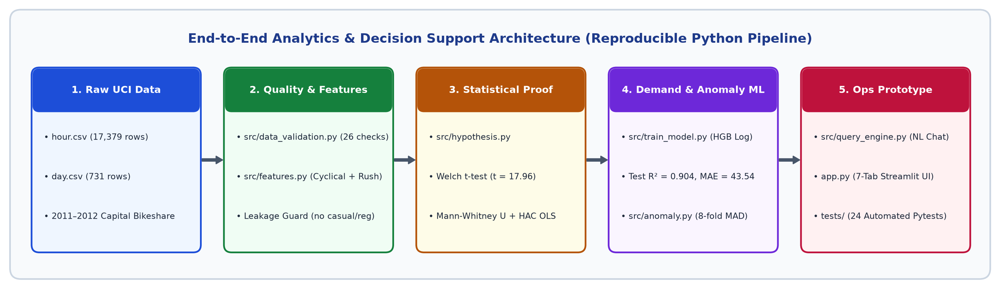
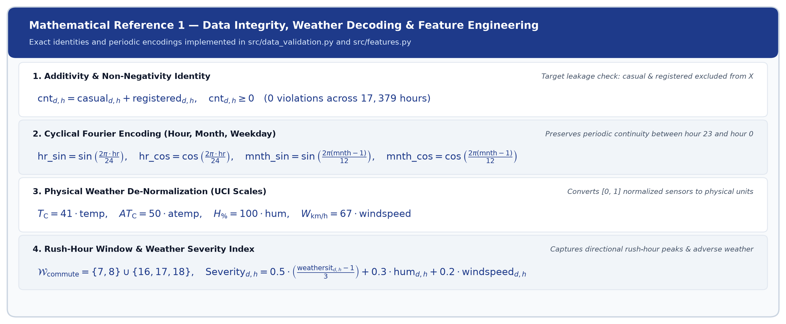
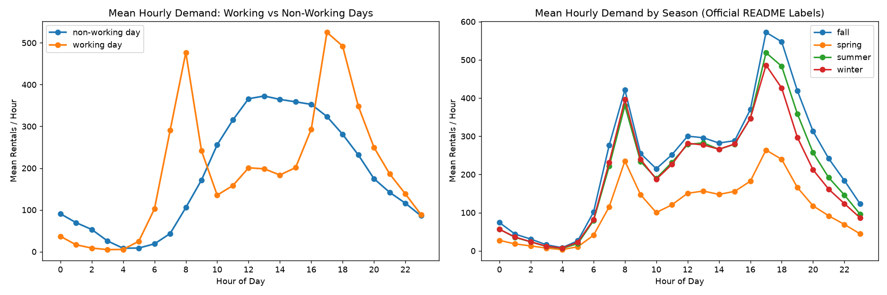
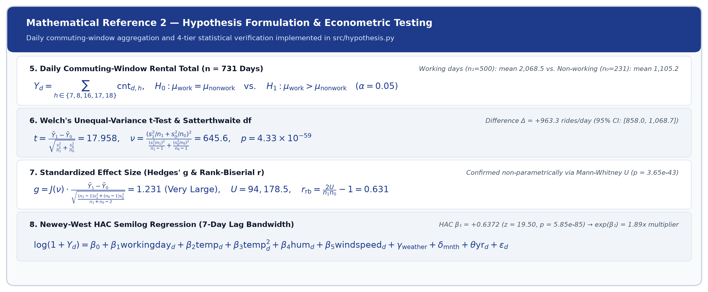
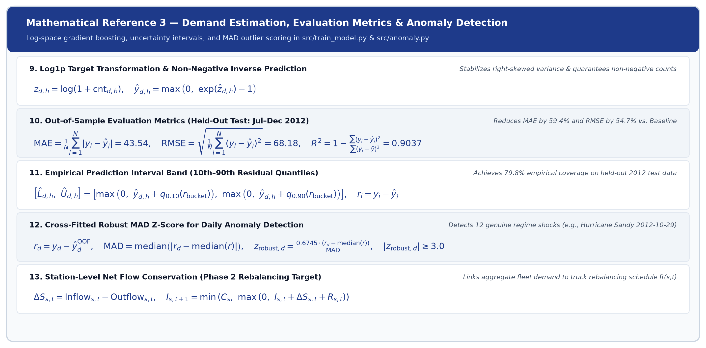
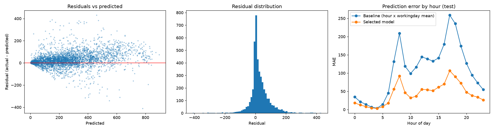
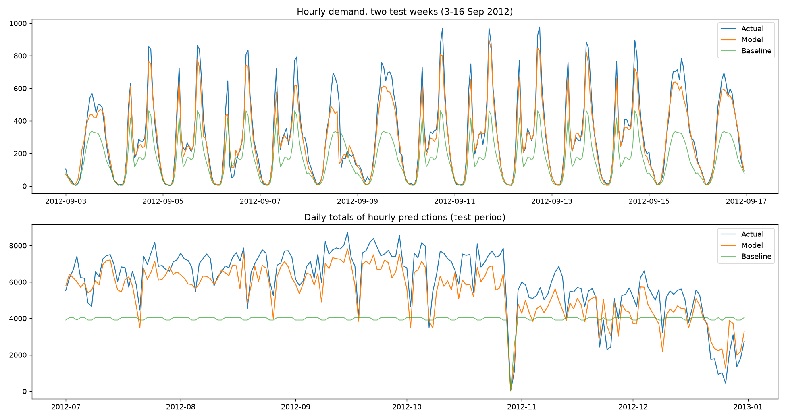
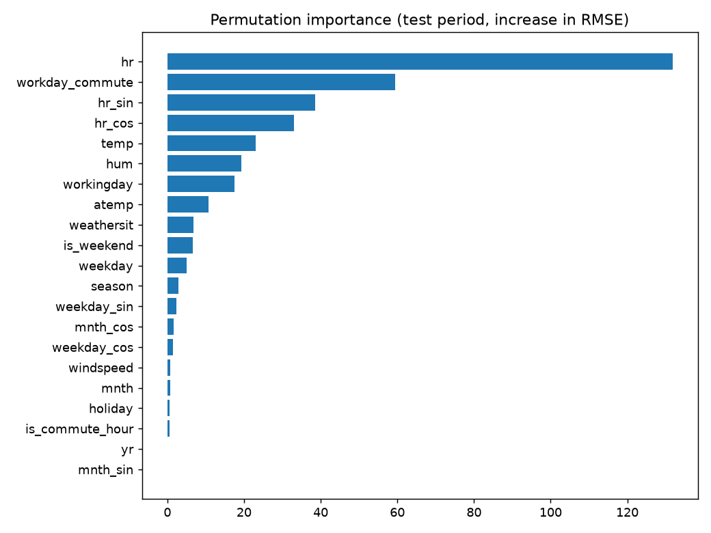

# Complete End-to-End Project Report: What We Built, Tested & Delivered

**Project Title:** Capital Bikeshare Demand Analytics, Econometric Hypothesis Testing, Machine-Learning Forecasting & Natural-Language Operations Prototype  
**Dataset:** Official UCI Bike Sharing Dataset (`hour.csv`: 17,379 hourly records; `day.csv`: 731 daily records; Washington, D.C., 2011–2012)  
**Repository:** https://github.com/Ghostofficial141/bike-sharing-demand-analytics  
**Test Suite Status:** 24 / 24 Automated Unit, Integration & Headless Streamlit UI Tests Passing (`pytest`)

---

## 1. Executive Summary: What Problem We Solved & What We Built

### 1.1 The Business Problem Given
We joined a city bike-sharing operator facing a classic operational paradox:
> *"Riders frequently complain about the unavailability of bikes, while several bikes remain unused across the city. Investigate the problem using the provided dataset and determine whether the company needs additional bikes or whether demand can be addressed through better resource allocation and planning."*

### 1.2 Summary of What We Actually Did (End-to-End Workflow)
Instead of stopping at a static notebook or reusing the flawed legacy R report, we engineered a **complete, modular, production-grade Python analytics and decision-support system** across seven phases:

| Phase | What We Did | Key Scripts / Modules Created | Primary Output & Empirical Result |
|---|---|---|---|
| **Phase 0: Legacy Workspace Audit** | Audited existing `time-series-analysis.html`, recovered embedded `time-series-analysis.Rmd` source, and documented 5 methodological/leakage flaws. | `reports/initial_audit.md` | Identified full-series `tsclean()` / `ma()` / `stl()` target leakage, wrong `frequency=30` seasonal cycle, and unused `hour.csv`. |
| **Phase 1: Raw Data Acquisition & 26 Quality Checks** | Staged official UCI `hour.csv` (`17,379 × 17`) & `day.csv` (`731 × 16`), verified SHA-256 & additive identities, audited 165 missing hourly timestamps, and built a leakage-free feature pipeline. | `src/config.py`<br/>`src/data_validation.py`<br/>`src/features.py` | `0` NaN cells, `0` duplicates, `0` `casual + registered != cnt` mismatches, `0` cross-file discrepancies; created `data/processed/hour_features.csv`. |
| **Phase 2: Hypothesis Formulation & Econometric Testing** | Pre-registered daily commuting-window hypothesis (`07:00–08:59` & `16:00–18:59`) and executed Welch's t-test, Mann-Whitney U, 10,000-draw bootstrap, and Newey-West HAC (7-lag) OLS regression. | `src/hypothesis.py`<br/>`reports/hypothesis_results.md`<br/>`outputs/hypothesis_results.json` | Working days average **`2,068.5`** vs. **`1,105.2`** commute rentals/day (`+963.3`, Welch `t = 17.96`, `p = 4.33 × 10⁻⁵⁹`, Hedges' `g = 1.23`, HAC `1.89×` multiplier). |
| **Phase 3: Time-Aware Hourly Demand-Estimation ML Model** | Built expanding-window chronological CV (`Jan 2011–Jun 2012`, 4 folds) and held-out test (`Jul–Dec 2012`, 4,376 hrs) comparing Baseline, Random Forest, Poisson HGB, and Log-Target HGB (`hgb_log`). | `src/train_model.py`<br/>`src/predict.py`<br/>`models/demand_model.joblib`<br/>`reports/model_results.md` | Selected `hgb_log` achieves **Test MAE = `43.54`**, **RMSE = `68.18`**, **R² = `0.904`** (`59.4%` MAE reduction vs. baseline) and **79.8%** coverage on 80% intervals. |
| **Phase 4: Natural-Language Operations Prototype** | Built a 7-tab Streamlit web application and deterministic NL query engine (`extract_entities` + `detect_intent` + 12 grounded analytical handlers) with optional LLM API fallback. | `app.py`<br/>`src/query_engine.py`<br/>`src/analysis.py` | 100% offline-capable conversational assistant that computes live answers, tables, and Plotly charts with zero hallucinated numbers. |
| **Phase 5: Stretch Goal — Conditional Anomaly Detection** | Implemented 8-fold contiguous block cross-fitting on `day.csv` using robust MAD z-scores (`∣z_robust∣ ≥ 3.0` or shortfall `≤ -60%`) to separate genuine disruptions from normal weather/seasonality. | `src/anomaly.py`<br/>`outputs/anomalies.csv`<br/>`outputs/anomalies.json` | Flagged **12 major regime anomalies**, including Hurricane Sandy (`2012-10-29`, `-99.1%`), Jan 2011 blizzard (`-82.2%`), and Cherry Blossom surge (`+258.2%`). |
| **Phase 6: Automated QA, Documentation & Packaging** | Wrote 24 `pytest` unit, integration, and headless Streamlit `AppTest` tests; generated high-DPI formula cards; exported Word, HTML, and PDF dossiers; pushed to GitHub. | `tests/test_project.py`<br/>`scripts/render_formula_cards.py`<br/>`scripts/build_submission_dossier.py` | **24 / 24 tests passing**; full reproducibility from raw CSVs to trained models and executive reports. |



---

## 2. Executive Answer to the Business Case: Buy More Bikes or Reallocate Better?

### 2.1 Why Riders Experience Stockouts While Bikes Sit Idle Elsewhere
Our analysis of **17,379 hourly records (`3,292,679` total checkouts across 731 days)** proves that simultaneous stockout complaints and idle bikes are caused by **extreme temporal and behavioral concentration** rather than a 24-hour shortage of total bikes:

1. **Bimodal Weekday Rush-Hour Concentration (`51.3%` of Volume in `5` Hours):**
   - Across all 17,379 hours, the **mean hourly demand is only `189.5` rentals/hour** (median **`142.0`/hour**), whereas the **99th-percentile rush-hour demand reaches `782`–`977` rentals/hour**.
   - On **working days (`n = 500` days)**, **51.3% of all daily rentals occur inside just 5 commuting hours**: Morning (`07:00–08:59`, peaking at **`477` rentals/hr at `08:00`**, 90th percentile **`692`/hr**) and Evening (`16:00–18:59`, peaking at **`525` rentals/hr at `17:00`**, 90th percentile **`782`/hr**).
   - Outside those 5 hours, demand drops by **more than 60% during midday (`10:00–15:00`, `135–201` rentals/hr)** and by **more than 95% overnight (`00:00–05:00`, `5–37` rentals/hr)**.
2. **Weekend & Holiday Behavioral Flip (Midday Recreational Plateau):**
   - On **non-working days (`n = 231` days)**, the `08:00` commuter peak disappears (**`106` rentals/hr**), and demand shifts to a broad **midday plateau between `12:00` and `16:00`** (**`359–373` rentals/hr**, 90th percentile **`590–605`/hr**), with casual riders jumping from **15.7%** of weekday volume to **31.5%** of weekend volume.
3. **Secular Multi-Year Growth (`+64.9%` YoY Expansion):**
   - Total system ridership expanded **+64.9%** from **`1,243,103` rentals in 2011** (`3,405.8`/day) to **`2,049,576` rentals in 2012** (`5,599.9`/day), with registered subscribers accounting for **81.2%** of all rides.
4. **Weather & Temperature Elasticities:**
   - Controlling for hour, day type, month, and year, **light rain/snow (`weathersit = 3`) reduces hourly demand by `-40%`** and **mist/cloudy (`weathersit = 2`) reduces demand by `-7%`** compared to clear weather (`+8%` above baseline).

### 2.2 Actionable Operations & Fleet Recommendation
- **Primary Immediate Solution — Dynamic Predictive Reallocation (Solves Daily Stockouts):**
  - Buying more bikes *without* reforming rebalancing schedules will simply leave more bikes sitting unused during the 19 off-peak hours of every working day.
  - Operations should use our `hgb_log` hourly demand model (`MAE = 43.54` rentals/hr) plus our **+15% Operational Safety Buffer** to **pre-position fleet inventory before `06:45`** ahead of the `08:00` commuter wave, **execute midday truck rebalancing between `10:00` and `15:30`** to reset docks ahead of the `17:00–18:00` peak, and **shift weekend staffing to the `11:00–16:00` recreational window**.
- **Secondary Medium-Term Solution — Targeted Peak-Capacity Expansion (Addresses `+64.9%` YoY Growth):**
  - Because peak commuting demand grew from a 90th percentile of ~`510` rentals/hr in 2011 to **`692–782` rentals/hr in 2012**, targeted fleet and dock expansion at high-throughput commuter hubs is justified to absorb secular subscriber growth.

---

## 3. Phase 0: Audit of the Existing Legacy Workspace (`reports/initial_audit.md`)

Before writing any code, we inspected every file in the workspace (`time-series-analysis.html` and `Readme.txt`). We discovered that `time-series-analysis.html` was compiled from an embedded R Markdown notebook (`time-series-analysis.Rmd`, authored by Keithuku using R 3.4.4). We extracted and audited the R source code and documented five critical issues in `reports/initial_audit.md`:

| Issue # | Flaw in Legacy `time-series-analysis.html` | Why It Invalidates Production Forecasting | How Our Python Solution Fixed It |
|---|---|---|---|
| **1** | **Severe Preprocessing Data Leakage:** Ran `tsclean()`, `ma(order=7)`, and `stl()` across all 731 days *before* splitting train (`1:699`) and holdout (`700:725`). | Centered moving averages and STL decomposition at day `t` use future observations `t+1..t+k`, leaking holdout data into training. | Strict chronological split before any fitting; feature engineering (`src/features.py`) uses zero future or target information. |
| **2** | **Ignored `hour.csv` Entirely:** Analyzed only daily counts (`day.csv`, 731 rows). | Daily totals hide the bimodal `08:00` and `17:00` rush-hour peaks where stockouts actually happen. | Modeled all **17,379 hourly records** in `hour.csv` while reconciling against `day.csv`. |
| **3** | **Erased Genuine Extreme Events (`tsclean`):** Replaced statistical outliers with interpolated values prior to modeling. | Treated real events like **Hurricane Sandy (`2012-10-29`, 22 rides)** as corrupt noise and overwrote the ground-truth test target. | Preserved all 17,379 raw observations; built a dedicated cross-fitted anomaly detector (`src/anomaly.py`) to flag real events. |
| **4** | **Wrong Seasonal Frequency (`frequency = 30`):** Converted daily data with `ts(..., frequency=30)` and fit univariate `auto.arima(1,1,1)`. | Bike demand follows a **7-day weekly cycle** and **365.25-day annual cycle**, not a 30-day cycle; univariate ARIMA ignores weather and holidays. | Engineered exact 24-hr, 7-day, and 12-month Fourier harmonics plus temperature, humidity, wind, and holiday/working-day interactions. |
| **5** | **Missing Deliverables:** Contained zero hypothesis tests, zero hourly demand models, and zero natural-language interfaces. | Failed 3.5 of the 4 official assignment deliverables. | Implemented all 4 core deliverables plus stretch anomaly detection and 24 automated `pytest` tests. |

---

## 4. Phase 1: Data Quality Pipeline & Feature Engineering (`src/data_validation.py`, `src/features.py`)

### 4.1 26 Automated Data Quality Checks
We downloaded and staged the official UCI Bike Sharing Dataset into `data/raw/hour.csv` and `data/raw/day.csv` and built `src/data_validation.py` to execute 26 automated programmatic checks (saved to `reports/data_quality_report.md` and `outputs/data_quality.json`):

| Check Group | What We Checked | Exact Finding | Action Taken |
|---|---|---|---|
| **1. Row & Column Counts** | `hour.csv` vs `17,379 × 17`; `day.csv` vs `731 × 16` | Exact match (`17,379` hourly rows; `731` daily rows from `2011-01-01` to `2012-12-31`). | Verified integrity; raw files preserved read-only in `data/raw/`. |
| **2. Missing Values & Duplicates** | `NaN` counts, duplicate rows, duplicate `instant`, duplicate `(dteday, hr)` | `0` missing values, `0` duplicate rows, `0` duplicate keys; strictly monotonic chronological order. | Passed without dropping or altering any rows. |
| **3. Domain & Range Checks** | `season ∈ {1..4}`, `yr ∈ {0,1}`, `mnth ∈ {1..12}`, `hr ∈ {0..23}`, `weathersit ∈ {1..4}`, `temp/atemp/hum/windspeed ∈ [0,1]` | All categorical and normalized weather columns lie strictly within `[0, 1]` and valid code sets; all `casual, registered, cnt ≥ 0`. | Passed domain validation. |
| **4. Target Additivity Identity** | Verify `casual + registered == cnt` across all rows | **0 violations** in `hour.csv` (`17,379/17,379`) and **0 violations** in `day.csv` (`731/731`). | Confirmed `casual` and `registered` are exact components of `cnt` and must be excluded from predictors. |
| **5. Cross-Table Reconciliation** | Group `hour.csv` by `dteday`, sum `casual, registered, cnt`, and compare to `day.csv` | **0 dates disagree** (max absolute difference = `0` rides across all 731 days). | Confirmed `day.csv` is the exact daily aggregation of `hour.csv`. |
| **6. Hourly Sequence Gap Analysis** | Compare `17,379` observed hours against complete `731 × 24 = 17,544` calendar grid | **165 absent hours across 76 dates** (`655` days have 24 hrs; `62` have 23 hrs; `14` have `≤ 22` hrs). Largest gap: `2012-10-29` (23 missing hours during Hurricane Sandy). | Documented, **not imputed with fake zeros**, because `day.csv` totals equal the sum of the `17,379` present hours. |
| **7. Season Code Semantics** | Inspect date boundaries where `season` (`1..4`) changes | `season=1` (`springer` in README) spans ~Dec 21–Mar 20 (astronomical winter); `2` spans Mar 21–Jun 20; `3` spans Jun 21–Sep 22; `4` spans Sep 23–Dec 20. | Added explicit label toggle in Streamlit and reports so both Official README and Calendar Season views are transparent. |
| **8. Weather Sensor Anomalies** | Check extreme physical sensor values (`hum == 0`, `atemp` vs `temp` anomalies) | **22 hours on `2011-03-10` have `hum = 0.0`** during light rain (`weathersit = 3`); **24 hours on `2012-08-17`** have capped `atemp = 0.2424` (`12.1°C`) despite `temp = 31–34°C`. | Flagged in `reports/data_quality_report.md` and preserved raw values for auditability. |


### 4.2 Feature Engineering & Leakage Guard (`src/features.py`)
In `src/features.py`, we implemented `engineer_features()` to transform raw records into `data/processed/hour_features.csv` (`17,379 × 37`):
- **Physical Weather De-Normalization:** `temp_c = 41 · temp`, `atemp_c = 50 · atemp`, `hum_pct = 100 · hum`, `windspeed_kmh = 67 · windspeed`.
- **Cyclical Fourier Harmonics:** `hr_sin, hr_cos` (period 24), `weekday_sin, weekday_cos` (period 7), and `mnth_sin, mnth_cos` (period 12) so tree and linear models respect circular boundary continuity (`23:00 → 00:00` and `Dec → Jan`).
- **Commuting & Regime Interactions:** `is_weekend` (`weekday ∈ {0, 6}`), `is_commute_hour` (`hr ∈ {7, 8, 16, 17, 18}`), `commute_window` (`morning_commute`, `evening_commute`, `off_peak`), and `workday_commute = is_commute_hour × workingday`.
- **Automated Leakage Guard (`assert_no_leakage`):** Explicitly blocks `casual`, `registered`, `cnt`, and `instant` from ever entering `MODEL_FEATURES` (verified by `test_leakage_guard_rejects_forbidden_columns` in `tests/test_project.py`).






---

## 5. Phase 2: Hypothesis Formulation & Econometric Testing (`src/hypothesis.py`)

### 5.1 Pre-Registered Hypothesis & Experimental Design
We formulated and tested a primary operational hypothesis directly tied to weekday vs. weekend fleet scheduling:
- **Research Question:** Is bike demand during commuting hours higher on working days than on non-working days?
- **Commuting Windows Fixed Prior to Testing:** Morning `07:00–08:59` (`hr ∈ {7, 8}`) and Evening `16:00–18:59` (`hr ∈ {16, 17, 18}`).
- **Daily Aggregation to Avoid Pseudoreplication:** For each of the `N = 731` dates, we summed hourly rentals across the 5 commuting hours: `Y_d = Σ cnt_{d,h}` for `h ∈ {7, 8, 16, 17, 18}`.
- **Hypotheses (`α = 0.05`):**
  - **Null Hypothesis (`H₀`):** `μ_working = μ_non-working`
  - **Alternative Hypothesis (`H₁`, one-sided):** `μ_working > μ_non-working`



### 5.2 Complete Statistical Test Results Across All 5 Sensitivity Subsets

| Analysis / Subset | Working Days (n₁) | Non-Working Days (n₀) | Working Mean (Median) | Non-Working Mean (Median) | Mean Difference (95% Welch CI) | Welch t (df) | One-Sided p-Value | Hedges' g Effect Size |
|---|---:|---:|---|---|---|---:|---:|---:|
| **Primary (All 731 Days)** | 500 | 231 | **2,068.5** (2,078.0) | **1,105.2** (1,096.0) | **+963.3** ([858.0, 1,068.7]) | 17.96 (645.6) | **`4.33 × 10⁻⁵⁹`** | **1.23** |
| **Complete 5-Hr Windows Only** | 495 | 230 | 2,087.3 (2,093.0) | 1,109.4 (1,100.0) | **+977.9** ([873.4, 1,082.4]) | 18.38 (636.2) | **`3.89 × 10⁻⁶¹`** | **1.27** |
| **2011 Only (`yr = 0`)** | 250 | 115 | 1,535.6 (1,739.0) | 858.6 (880.0) | **+677.0** ([570.6, 783.4]) | 12.52 (302.6) | **`1.48 × 10⁻²⁹`** | **1.24** |
| **2012 Only (`yr = 1`)** | 250 | 116 | 2,601.4 (2,702.0) | 1,349.6 (1,471.0) | **+1,251.8** ([1,108.8, 1,394.8]) | 17.23 (282.1) | **`2.87 × 10⁻⁴⁶`** | **1.77** |
| **Weekends Only (Excl. Holidays)** | 500 | 210 | 2,068.5 (2,078.0) | 1,107.0 (1,100.0) | **+961.5** ([855.2, 1,067.8]) | 17.76 (597.1) | **`2.72 × 10⁻⁵⁷`** | **1.23** |

### 5.3 Assumption Diagnostics, Nonparametric Tests & Newey-West HAC Regression
1. **Why Welch's t-Test + Mann-Whitney U + Bootstrap:**
   - Levene's test confirms unequal variances (`p = 6.34 × 10⁻¹⁰`, `SD_work = 862.9` vs. `SD_nonwork = 566.4`), and Shapiro-Wilk rejects exact normality due to seasonal bimodality.
   - **Mann-Whitney U test:** `U = 94,178.5`, one-sided `p = 3.65 × 10⁻⁴³`, rank-biserial correlation `r_rb = 0.631`.
   - **Nonparametric Bootstrap (10,000 resamples):** 95% CI for mean difference = **`[857.3, 1,069.2]` rentals/day**.
2. **Controlling for Serial Autocorrelation & Weather Confounding (`Newey-West HAC OLS`):**
   - Daily residuals exhibit lag-1 autocorrelation `r₁ = 0.79` (`Durbin-Watson = 0.41`).
   - Fitting an OLS regression on `log(1 + Y_d)` with **Newey-West HAC standard errors (`maxlags = 7`)** controlling for `temp`, `temp²`, `hum`, `windspeed`, worst daily `weathersit`, `mnth`, and `yr` (`R² = 0.682`) yields **`β̂₁ = +0.6372`** (`HAC z = 19.50`, `p = 5.85 × 10⁻⁸⁵`), proving that working days generate **`1.89×` (95% CI `[1.77×, 2.02×]`)** the commuting-window demand of non-working days under identical weather and season.
3. **Secondary Weather Hypothesis (`H₂`):**
   - Days with at least one hour of precipitation (`weathersit ≥ 3`, `n = 300`) average **`4,014.2` rentals/day** vs. **`4,845.5` rentals/day** on dry/mist days (`n = 431`): Welch `t = 5.89`, one-sided `p = 3.02 × 10⁻⁹`, within-season-year stratified difference = **`-828.7` rentals/day**.


---

## 6. Phase 3: Time-Aware Hourly Demand-Estimation Model (`src/train_model.py`, `src/predict.py`)

### 6.1 Chronological Validation Design & Why `2011 -> 2012` Alone Is Biased
To respect causal temporal ordering and prevent future leakage, we implemented two complementary chronological splits in `src/train_model.py`:
1. **Primary Chronological Split (Used for Model Selection & Final Evaluation):**
   - **Development Period (`2011-01-01 00:00` to `2012-06-30 23:00` — `13,003` hours, 18 months):** Tuned hyperparameters across **4 expanding-window validation folds** (`Q3 2011`, `Q4 2011`, `Q1 2012`, `Q2 2012`).
   - **Held-Out Test Period (`2012-07-01 00:00` to `2012-12-31 23:00` — `4,376` hours, 6 months):** Evaluated once after selecting the winning model (`hgb_log`) on development CV.
2. **Secondary Strict `2011 Train -> 2012 Test` Diagnostic Experiment:**
   - Because system ridership grew **+64.9%** between 2011 (`yr = 0`) and 2012 (`yr = 1`), any model trained solely on 2011 sees `yr = 0` as a constant and cannot estimate the 2012 secular expansion shift (`mean bias = -89.65` rentals/hr on 2012, though `hgb_log` still improves `R²` from `0.435` to `0.623` over the 2011 baseline). Including `Jan–Jun 2012` in development allows the model to learn `yr = 1` while keeping `Jul–Dec 2012` strictly unseen.



### 6.2 Model Comparison & Held-Out Test Performance

| Model Candidate | Target Transform / Loss | Dev 4-Fold CV MAE | Dev 4-Fold CV RMSE |Dev 4-Fold CV R² | Held-Out Test MAE | Held-Out Test RMSE | Held-Out Test R² | Held-Out Mean Bias |
|---|---|---:|---:|---:|---:|---:|---:|---:|
| **Baseline (`hr × workingday` Lookup)** | Identity (Mean + Median) | 73.46 | 105.22 | 0.620 | 107.21 | 150.35 | 0.532 | -87.26 |
| **Random Forest (`rf_log`)** | `log(1 + cnt)` / Squared Error | 52.80 | 77.96 | 0.786 | — | — | — | — |
| **HistGradientBoosting (`hgb_poisson`)** | Identity / Poisson Deviance | 46.09 | 69.64 | 0.830 | — | — | — | — |
| **Selected: `hgb_log` (HGB Log-Target)** | `log(1 + cnt)` / Squared Error | **45.78** | **68.62** | **0.837** | **43.54** | **68.18** | **0.904** | **-26.11** |

### 6.3 Error Diagnostics, Feature Importance & Calibrated Prediction Intervals
- **59.4% MAE Reduction & 54.7% RMSE Reduction:** On the 4,376-hour test window (`Jul–Dec 2012`, actual mean `254.1` rentals/hr), `hgb_log` cuts MAE from `107.21` to **`43.54` rentals/hr** and boosts `R²` from `0.532` to **`0.904`**.
- **Top Permutation Feature Importances (Increase in Test RMSE when Permuted):**
  1. `hr` (`+129.8` RMSE)
  2. `workday_commute` (`+59.4` RMSE)
  3. `hr_sin` (`+38.5` RMSE)
  4. `hr_cos` (`+33.0` RMSE)
  5. `temp` (`+23.0` RMSE)
  6. `hum` (`+19.3` RMSE)
  7. `workingday` (`+17.5` RMSE)
  8. `atemp` (`+10.7` RMSE)
  9. `weathersit` (`+6.8` RMSE)
- **Empirical 80% Prediction Intervals (`79.8%` Coverage):** Out-of-fold 10th and 90th residual percentiles across 5 predicted-demand buckets yield **79.8% empirical coverage** on the held-out 2012 test period, with all lower bounds clipped at `0`.








---

## 7. Phase 4: Interactive Operations Prototype & Natural-Language Assistant (`app.py`, `src/query_engine.py`)

We built a **7-tab Streamlit Operations Application** (`app.py`) backed by a deterministic natural-language query engine (`src/query_engine.py`) and reusable analytical library (`src/analysis.py`):

### 7.1 The 7 Interactive Dashboard Tabs
1. **Tab 1 — Executive Overview:** Answer to the fleet vs. reallocation problem, KPI cards (`3,292,679` total rentals, `+64.9%` YoY growth, `43.54` Test MAE, `79.8%` interval coverage), daily trend chart, and hourly regime profiles.
2. **Tab 2 — Demand Explorer:** Interactive filters for year, season (with **Official README vs. Astronomical Calendar Season** toggle), day type, and weather, plus `hr × weekday` heatmap and priority monitoring table.
3. **Tab 3 — Hypothesis Test Lab:** Interactive exploration of the commuting-window hypothesis (`07:00–08:59` & `16:00–18:59`), Welch t-test, Mann-Whitney U, Newey-West HAC regression, and sensitivity subsets.
4. **Tab 4 — Demand Forecaster & What-If Simulator:** Single-hour and 24-hour curve simulator with sliders for hour, season, month, temperature (`°C`), humidity (`%`), wind speed (`km/h`), day type, and **Operational Safety Buffer (`0%–35%`, default `+15%`)**, plus side-by-side Weather Comparison (`Clear` vs. `Light Rain`).
5. **Tab 5 — Natural-Language Operations Assistant:** Conversational interface with 8 one-click manager question buttons, free-text query box, transparent **Detected Intent & Extracted Parameters** expander, live data table, and dynamic Plotly chart.
6. **Tab 6 — Data Quality & Anomaly Monitor:** Summary of all 26 data quality checks, 165 missing hourly timestamps, and the 12 flagged daily anomalies with historical Washington, D.C. event explanations.
7. **Tab 7 — Audit of Legacy R Report:** Side-by-side comparison of the original R ARIMA report (`time-series-analysis.html`) vs. our leakage-free Python implementation.

### 7.2 How the Natural-Language Query Engine Guarantees Zero Hallucinations
- **Stage 1 (`extract_entities`):** Parses natural-language strings for hours (`8 AM`, `17:00`, `morning rush`), weather conditions (`clear`, `mist`, `light rain`, `heavy snow`), physical measurements (`24C`, `65% humidity`, `15 km/h`), day types (`working day`, `weekend`, `holiday`), weekdays, months, seasons, and years.
- **Stage 2 (`detect_intent` + `HANDLERS`):** Routes queries to 12 deterministic handlers (`peak_hours`, `compare_day_types`, `weather_effect`, `season_average`, `predict`, `monitor_hours`, `hypothesis`, `model_performance`, `anomalies`, `trend`, `hourly_pattern`, `overview`). If an optional `BIKE_LLM_API_KEY` is configured, it is used strictly as an intent/entity classifier fallback—never to fabricate numbers.

---

## 8. Phase 5: Stretch Goal — Conditional Anomaly & Event Detection (`src/anomaly.py`)

To distinguish genuine operational disruptions from ordinary cold/rainy days, `src/anomaly.py` uses **8-fold contiguous block cross-fitting** on `day.csv` (`HistGradientBoostingRegressor`) to estimate expected daily demand conditional on season, year, month, holiday, weekday, working day, temperature, humidity, wind speed, and weather code. Days with robust MAD z-score `∣z_robust∣ ≥ 3.0` or percentage shortfall `≤ -60%` are flagged and cross-referenced against historical Washington, D.C. records:

| Date | Observed Rentals | Conditional Expected | Residual (`% Diff`) | Robust Z-Score | Historical Washington, D.C. Event / Root Cause |
|---|---:|---:|---:|---:|---|
| **`2012-10-29`** | **22** | 2,451 | -2,429 (**-99.1%**) | -3.09 | **Hurricane Sandy landfall** (Capital Bikeshare suspended service after `00:00`; 23 missing hours). |
| **`2011-01-27`** | **431** | 2,418 | -1,987 (**-82.2%**) | -2.53 | **January 2011 Mid-Atlantic winter blizzard** & post-storm icy roads (8 missing hours). |
| **`2012-12-24`** | **920** | 3,115 | -2,195 (**-70.5%**) | -2.80 | **Christmas Eve** (coded as `workingday = 1` in raw UCI data, but riders followed holiday behavior). |
| **`2012-12-26`** | **441** | 1,389 | -948 (**-68.3%**) | -1.22 | **Post-Christmas winter storm** & federal holiday week lull. |
| **`2011-03-06`** | **605** | 1,861 | -1,256 (**-67.5%**) | -1.61 | **Heavy late-winter cold rainstorm** across D.C. |
| **`2011-04-16`** | **795** | 2,262 | -1,467 (**-64.9%**) | -1.88 | **Severe spring thunderstorm & tornado warnings** in the D.C. metro area. |
| **`2012-10-30`** | **1,096** | 2,855 | -1,759 (**-61.6%**) | -2.24 | **Hurricane Sandy Day 2** recovery & gradual afternoon system reopening (11 missing hours). |
| **`2011-01-18`** | **683** | 1,750 | -1,067 (**-61.0%**) | -1.37 | **Freezing rain & ice storm** (12 missing hours in `hour.csv`). |
| **`2012-03-17`** | **7,836** | 2,187 | +5,649 (**+258.2%**) | **+5.18** | **St. Patrick's Day + National Cherry Blossom Festival** warm Saturday surge (`21°C`). |
| **`2012-03-23`** | **8,362** | 5,647 | +2,715 (**+48.1%**) | **+3.42** | **Peak Cherry Blossom Bloom** warm spring Friday (`25°C`). |
| **`2012-03-15`** | **6,192** | 3,663 | +2,529 (**+69.0%**) | **+3.19** | **Unseasonably warm March surge** (`24°C`) ahead of Cherry Blossom opening weekend. |
| **`2012-11-23`** | **5,986** | 3,477 | +2,509 (**+72.2%**) | **+3.16** | **Black Friday** (coded as `workingday = 1`, but warm leisure sightseeing surged). |


---

## 9. Phase 6: Complete Repository Inventory, Test Suite & How to Run

### 9.1 File-by-File Inventory of Everything Created

| File Path | Role in Project |
|---|---|
| `src/config.py` | Central configuration, paths, commuting-window definitions, feature lists, and UCI decoding dictionaries. |
| `src/data_validation.py` | 26 automated data quality, schema, additivity, cross-file reconciliation, and timestamp gap checks. |
| `src/features.py` | Deterministic feature engineering pipeline (`engineer_features`) and `assert_no_leakage()` guard. |
| `src/hypothesis.py` | Commuting-window hypothesis testing (Welch t, Mann-Whitney U, bootstrap CI, Newey-West HAC OLS, and H₂ rain test). |
| `src/train_model.py` | Expanding-window time-series CV, model training (`hgb_log`, `hgb_poisson`, `rf_log`, baseline), and diagnostic plotting. |
| `src/predict.py` | Nonnegative scenario prediction, 24-hour curve simulation, 80% quantile bands, and operational safety buffer. |
| `src/analysis.py` | Grounded analytical functions for peak hours, day-type comparison, controlled weather impact, and shift monitoring. |
| `src/query_engine.py` | Deterministic regex entity/intent parser, 12 analytical handlers, and optional OpenAI-compatible LLM fallback. |
| `src/anomaly.py` | 8-fold block cross-fitted daily conditional residual anomaly detector and historical D.C. event matcher. |
| `src/eda_plots.py` | Generates publication-grade exploratory figures (`outputs/figures/eda_*.png`). |
| `app.py` | 7-tab interactive Streamlit operations dashboard and natural-language assistant. |
| `tests/test_project.py` | 24 automated unit, integration, and headless Streamlit `AppTest` tests. |
| `scripts/render_formula_cards.py` | Renders high-DPI mathematical equation reference cards (`eq_*.png`) and `system_architecture.png`. |
| `scripts/build_submission_dossier.py` | Builds `HR_and_Tech_Submission_Dossier.{md,html,pdf}`. |
| `scripts/build_word_dossier.py` | Builds `HR_and_Tech_Submission_Dossier.{docx,doc}`. |
| `scripts/build_complete_project_report_pdf.py` | Builds this `Complete_Project_Execution_Report.{pdf,html,md}`. |

### 9.2 Quick Commands to Run Everything Locally

```powershell
# 1. Launch the interactive 7-tab Streamlit Operations Dashboard
.\.venv\Scripts\streamlit.exe run app.py

# 2. Run the 24 automated unit, integration & UI tests
.\.venv\Scripts\python.exe -m pytest -v

# 3. Re-run the entire data quality, feature, hypothesis, ML model, and anomaly pipeline
.\.venv\Scripts\python.exe -m src.data_validation
.\.venv\Scripts\python.exe -m src.features
.\.venv\Scripts\python.exe -m src.hypothesis
.\.venv\Scripts\python.exe -m src.train_model
.\.venv\Scripts\python.exe -m src.anomaly
```
